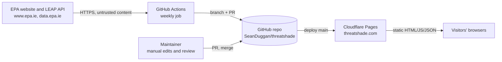

# Threat model inputs

This is a starting point for the threat model, not the finished model. It lists what the system is made of, how data moves, where trust changes, and the risks already identified, so the session can focus on judging and extending them.

## System summary

A static site on Cloudflare Pages, built from a GitHub repository. A weekly GitHub Actions job fetches public EPA data and opens a pull request. A human reviews and merges, and Cloudflare deploys `main`.

## Assets

| Asset | Why it matters |
|---|---|
| Integrity of scores and claims about named organisations | Wrong or tampered claims cause legal (defamation) and reputational harm |
| The deployed site and domain (threatshade.com) | Defacement, malicious scripts served to visitors, phishing from a trusted domain |
| GitHub account `SeanDuggan` and the repository | Control of the account means control of the site |
| Cloudflare account, DNS and Pages project | Same as above, plus DNS hijack |
| Availability of the site | A public-interest site may be targeted by organisations it ranks |
| Visitor privacy | The site sets no cookies and has no analytics; keep it that way or assess any addition |

## Actors

- Visitors (anonymous, untrusted).
- Organisations listed on the scoreboard, who may be motivated to discredit, take down or alter the site.
- Opportunistic attackers (automated scanning, credential stuffing, supply-chain attacks).
- Upstream data publishers (EPA websites and API). Trusted for accuracy but treated as untrusted input technically, because they could be compromised or change format.
- The maintainer (Sean), with GitHub and Cloudflare access.
- GitHub Actions runners and the built-in `GITHUB_TOKEN`.

## Data flow

## Trust boundaries

1. **EPA to GitHub Actions.** External content enters the pipeline. Controls: host allowlist, redirect blocking, size and time limits, strict parsing, plausibility bounds, validation.
2. **GitHub Actions to the repository.** The bot can push a branch and open a PR, but cannot merge to `main` if branch protection is on.
3. **Repository to production.** Only `main` deploys. Controls: required review, required checks, CODEOWNERS.
4. **Server to browser.** Visitors get static files. Controls: CSP, no inline code, DOM-only rendering, link allowlist.
5. **Browser to third parties.** None. Fonts are self-hosted, so visitors only contact the site's own origin.

## Entry points

- Public HTTP(S) requests to the site.
- Data fetched from EPA endpoints.
- Pull requests and pushes to the repository.
- GitHub and Cloudflare account logins, and any API tokens created later.
- DNS records for the domain.

## Risks already identified (STRIDE prompts)

| # | Category | Risk | Current control | Open question |
|---|---|---|---|---|
| 1 | Tampering | Malicious or malformed text from a compromised EPA page reaches the site (stored XSS) | Validator rejects markup; DOM-only rendering; CSP blocks inline and third-party script | Should the fetcher be allowed to write any free text at all? (Today it writes none to `data.json`.) |
| 2 | Tampering | A page redesign makes the parser mark everyone "not on the list" | Step skipped if 0 or more than 40 rows; status changes are flagged in the PR | Add a minimum-overlap check with last week's list? |
| 3 | Spoofing | Takeover of the GitHub or Cloudflare account | 2FA (to enable), branch protection | Hardware keys? Separate Cloudflare account with least privilege? |
| 4 | Elevation | Workflow injection or token misuse | Least-privilege permissions, no secrets, pinned actions, env-var passing, no `pull_request_target` | Restrict Actions to GitHub-owned actions only in repo settings? |
| 5 | Tampering | Supply chain (a compromised GitHub Action) | SHA pinning, Dependabot, stdlib-only scripts, self-hosted fonts | Restrict Actions to GitHub-owned actions only? |
| 6 | Repudiation | Unclear who changed a score and why | Git history, PR review, evidence entries with sources | Signed commits? Public changelog page? |
| 7 | Information disclosure | Personal data in the repo or site (emails, private individuals) | Only organisations are listed; no analytics | Policy for sole traders or small farms appearing in EPA lists |
| 8 | Denial of service | Takedown pressure or traffic floods from listed organisations | Cloudflare edge caching | Legal takedown process; backup hosting |
| 9 | Spoofing | Look-alike domains or a cloned site spreading false scores | None yet | Monitor for look-alikes; publish a data hash? |
| 10 | Tampering (non-technical) | Legal or reputational damage from a wrong claim | Sources on every claim, human review, disclaimer | Corrections process and response time |

## Assumptions to confirm

- The repository stays private until launch, or forks cannot trigger deployments.
- Nobody other than the maintainer has write access.
- No analytics, comments, contact form or other dynamic feature will be added without revisiting this model.
